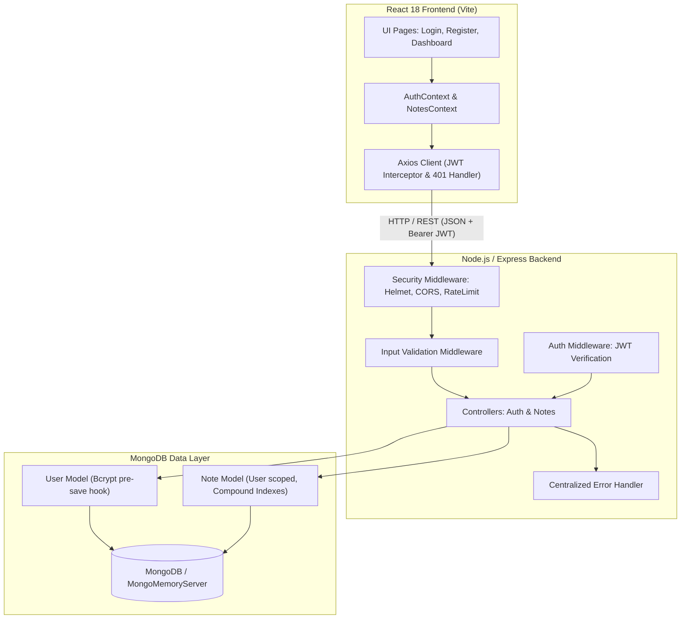

# NoteSphere — Full-Stack User Notes Application

A production-ready, secure, full-stack personal notes application built with **Node.js**, **Express**, **MongoDB (Mongoose)**, and **React (Vite)**. Designed adhering to enterprise software engineering standards, clean architecture, separation of concerns, and robust security principles.

---

## 🏛️ System Architecture



---

## 🚀 Key Features

### Backend (Node.js & Express)
- **User Authentication**: Secure user registration (`POST /register` & `/api/auth/register`) and login (`POST /login` & `/api/auth/login`).
- **Cryptographic Security**: Passwords hashed using `bcryptjs` with salt factor 10.
- **Stateless Authorization**: Signed JSON Web Tokens (JWT) with configurable expiration (`process.env.JWT_EXPIRES_IN`).
- **Strict Data Isolation (IDOR Prevention)**: All note queries are explicitly scoped to the authenticated user ID (`{ _id: noteId, user: req.user._id }`). Users cannot read, modify, or delete notes belonging to other users.
- **Full CRUD for Notes**:
  - `GET /api/notes` (supports regex search on title/content and category filtering)
  - `GET /api/notes/:id`
  - `POST /api/notes`
  - `PUT /api/notes/:id`
  - `DELETE /api/notes/:id`
- **Zero-Config Database**: Seamless dual-mode database engine. Uses `MONGODB_URI` when provided, or automatically starts an embedded in-memory MongoDB (`mongodb-memory-server`) for frictionless local evaluation without requiring external services.
- **Security & Hygiene**: `helmet` headers, configurable `cors`, `express-rate-limit` against brute-force login attempts, and production-safe centralized error handling.

### Frontend (React & Vite)
- **Modern React 18**: Functional components with hooks (`useState`, `useEffect`, `useCallback`, `useContext`).
- **Global State Management**: Clean context architecture with `AuthContext` (session lifecycle & persistence) and `NotesContext` (CRUD operations & filter states).
- **Interactive Dashboard**:
  - Pin/unpin notes to top
  - Live search across titles and note contents
  - Category filter pills (*All, Work, Personal, Ideas, Projects, Finance, General*)
  - Create and edit modals with client-side form validation
  - Destructive action confirmation dialogs
- **Resilient API Integration**: Axios client with request interceptors (automatic Bearer token attachment) and response interceptors (graceful 401 token expiry handling).
- **Responsive & Accessible UI**: Custom design system crafted with modern CSS variables, responsive CSS grid, glassmorphism navbar, and lucide icons.

---

## 📁 Project Structure

```
notes-app/
├── package.json               # Root scripts & orchestrator
├── README.md                  # System documentation
├── .gitignore
│
├── server/                    # Node.js + Express REST API
│   ├── package.json
│   ├── .env.example
│   ├── vitest.config.js       # Test configuration
│   ├── src/
│   │   ├── config/
│   │   │   └── db.js          # MongoDB connection with MongoMemoryServer fallback
│   │   ├── controllers/
│   │   │   ├── authController.js   # Registration, login, profile
│   │   │   └── noteController.js   # Notes CRUD with user isolation
│   │   ├── middleware/
│   │   │   ├── authMiddleware.js   # Bearer JWT verification
│   │   │   ├── errorMiddleware.js  # 404 & Centralized error handler
│   │   │   └── validateMiddleware.js # Input validation rules
│   │   ├── models/
│   │   │   ├── User.js        # User schema with bcrypt hooks
│   │   │   └── Note.js        # Note schema with indexes & timestamps
│   │   ├── routes/
│   │   │   ├── authRoutes.js  # /register, /login, /me
│   │   │   └── noteRoutes.js  # /api/notes CRUD
│   │   ├── utils/
│   │   │   └── generateToken.js
│   │   ├── app.js             # Express application assembly
│   │   └── server.js          # Server entry point & graceful shutdown
│   └── tests/
│       ├── globalSetup.js     # Shared in-memory test database setup
│       ├── auth.test.js       # Authentication test suite
│       └── notes.test.js      # Notes CRUD & IDOR security test suite
│
└── client/                    # React 18 + Vite Frontend
    ├── package.json
    ├── index.html
    ├── vite.config.js
    └── src/
        ├── api/
        │   └── axiosClient.js # Axios instance with interceptors
        ├── context/
        │   ├── AuthContext.jsx # Authentication state & actions
        │   └── NotesContext.jsx # Notes state & filtering
        ├── components/
        │   ├── common/        # Navbar, Modal, Alert, Spinner, ProtectedRoute
        │   └── notes/         # NoteCard, NoteFormModal, DeleteConfirmModal, SearchBar
        ├── pages/
        │   ├── LoginPage.jsx
        │   ├── RegisterPage.jsx
        │   ├── DashboardPage.jsx
        │   └── NotFoundPage.jsx
        ├── styles/
        │   └── index.css      # Design system stylesheet
        ├── App.jsx
        └── main.jsx
```

---

## ⚡ Quick Start Guide

### Prerequisites
- **Node.js** (v18 or higher; tested on Node.js v24)
- **npm** (v9 or higher)

### Installation
Run the following from the root `notes-app` directory:

```bash
# 1. Install root dependencies
npm install

# 2. Install backend dependencies
cd server && npm install && cd ..

# 3. Install frontend dependencies
cd client && npm install && cd ..
```

### Running the Application

You can start both frontend and backend concurrently with a single command from the root directory:

```bash
npm run dev
```

Or run them individually in separate terminals:

```bash
# Terminal 1: Backend API (runs on http://localhost:5000)
npm run server:dev

# Terminal 2: Frontend Client (runs on http://localhost:5173)
npm run client:dev
```

Open **http://localhost:5173** in your browser.

> **Zero-Configuration Database Note**: You do NOT need to install or start a local MongoDB service. If no `MONGODB_URI` environment variable is specified, the application automatically boots an embedded in-memory MongoDB instance instantly.

---

## 🧪 Automated Testing

The backend includes a comprehensive integration test suite covering authentication, validation, error handling, note CRUD operations, and multi-tenant user isolation.

To run the test suite:

```bash
npm test
# or inside the server directory:
cd server && npm test
```

### Test Suite Summary
- **Authentication (`tests/auth.test.js`)**:
  - `POST /api/auth/register` registration with password hashing.
  - `POST /register` backward-compatible root alias.
  - Duplicate email rejection.
  - Email format & password length validation.
  - `POST /api/auth/login` valid authentication.
  - `POST /login` root alias.
  - Invalid credentials rejection.
  - `GET /api/auth/me` with valid JWT.
  - Rejection of unauthenticated requests.
- **Notes CRUD & Security Isolation (`tests/notes.test.js`)**:
  - `POST /api/notes` create note for authenticated user.
  - Rejection of notes without required fields.
  - Rejection of unauthenticated requests.
  - `GET /api/notes` strictly returns user-owned notes.
  - `GET /api/notes/:id` owner access.
  - **Security Test**: User B receives `404 Not Found` when attempting to read User A's note.
  - `PUT /api/notes/:id` owner updates.
  - **Security Test**: User B cannot update User A's note.
  - **Security Test**: User B cannot delete User A's note.
  - `DELETE /api/notes/:id` owner deletion.

---

## 📖 API Reference

### Base URLs
- Auth Endpoints: `/api/auth` (and aliases `/register`, `/login`)
- Notes Endpoints: `/api/notes`

### Authentication Endpoints

#### 1. Register User
`POST /api/auth/register` or `POST /register`
- **Body**:
  ```json
  {
    "name": "Alex Developer",
    "email": "alex@example.com",
    "password": "securepassword123"
  }
  ```
- **Success (201 Created)**:
  ```json
  {
    "success": true,
    "message": "User registered successfully",
    "token": "eyJhbGciOiJIUzI1NiIsIn...",
    "user": {
      "_id": "6732f18070...",
      "name": "Alex Developer",
      "email": "alex@example.com",
      "createdAt": "2026-11-12T05:00:00.000Z"
    }
  }
  ```

#### 2. User Login
`POST /api/auth/login` or `POST /login`
- **Body**:
  ```json
  {
    "email": "alex@example.com",
    "password": "securepassword123"
  }
  ```
- **Success (200 OK)**:
  ```json
  {
    "success": true,
    "message": "Login successful",
    "token": "eyJhbGciOiJIUzI1NiIsIn...",
    "user": {
      "_id": "6732f18070...",
      "name": "Alex Developer",
      "email": "alex@example.com"
    }
  }
  ```

#### 3. Current User Profile
`GET /api/auth/me`
- **Headers**: `Authorization: Bearer <token>`
- **Success (200 OK)**: Returns the current user profile.

---

### Notes Endpoints (Protected — Requires Bearer Token)

#### 1. List Notes
`GET /api/notes`
- **Headers**: `Authorization: Bearer <token>`
- **Query Parameters (Optional)**:
  - `search` (string): Case-insensitive search on title and content
  - `category` (string): Filter by category (*Work, Personal, Ideas, etc.*)
  - `isPinned` (boolean): Filter by pinned status
- **Success (200 OK)**:
  ```json
  {
    "success": true,
    "count": 2,
    "notes": [
      {
        "_id": "6732f22b70...",
        "user": "6732f18070...",
        "title": "System Architecture Draft",
        "content": "Review authentication middleware and indexes.",
        "category": "Work",
        "isPinned": true,
        "createdAt": "2026-11-12T05:10:00.000Z",
        "updatedAt": "2026-11-12T05:15:00.000Z"
      }
    ]
  }
  ```

#### 2. Create Note
`POST /api/notes`
- **Headers**: `Authorization: Bearer <token>`
- **Body**:
  ```json
  {
    "title": "Meeting Notes",
    "content": "Discussed roadmap and deployment schedule.",
    "category": "Work",
    "isPinned": false
  }
  ```
- **Success (201 Created)**: Returns the created note object.

#### 3. Get Note By ID
`GET /api/notes/:id`
- **Headers**: `Authorization: Bearer <token>`
- **Success (200 OK)**: Returns note if owned by authenticated user; `404 Not Found` otherwise.

#### 4. Update Note
`PUT /api/notes/:id` or `PATCH /api/notes/:id`
- **Headers**: `Authorization: Bearer <token>`
- **Body**: Partial or full note fields (`title`, `content`, `category`, `isPinned`).
- **Success (200 OK)**: Returns updated note.

#### 5. Delete Note
`DELETE /api/notes/:id`
- **Headers**: `Authorization: Bearer <token>`
- **Success (200 OK)**:
  ```json
  {
    "success": true,
    "message": "Note deleted successfully",
    "id": "6732f22b70..."
  }
  ```

---

## 🔒 Security Best Practices Implemented

1. **Authorization Scoping (IDOR Prevention)**: Queries are structured with both document ID and user ID (`{ _id: id, user: req.user._id }`). Attempts to access another user's notes return `404 Not Found`, preventing resource enumeration.
2. **Password Hashing**: Utilizes `bcryptjs` with salt rounds 10. Raw passwords are never stored or logged, and `password` is marked with `select: false` on the User model.
3. **Stateless JWTs**: Tokens are validated on every request via `authMiddleware.js`.
4. **Rate Limiting**: `express-rate-limit` prevents credential stuffing and brute-force attacks on `/register` and `/login`.
5. **HTTP Security Headers**: `helmet` is enabled to mitigate XSS, clickjacking, and MIME-type sniffing.
6. **Input Sanitization & Validation**: Comprehensive validation middleware validates field existence, format (RFC-compliant email regex), and character lengths before processing.
7. **Error Masking**: Stack traces are suppressed in production environments, exposing only clean error descriptions to API consumers.

---

## ⚙️ Environment Variables

A `.env.example` file is included in `server/.env.example`:

| Variable | Description | Default |
| :--- | :--- | :--- |
| `PORT` | Backend server port | `5000` |
| `NODE_ENV` | Environment mode (`development`, `production`, `test`) | `development` |
| `MONGODB_URI` | MongoDB connection string (Atlas or local) | *In-memory fallback if omitted* |
| `JWT_SECRET` | Secret key for signing JWT tokens | `super_secret_jwt_key...` |
| `JWT_EXPIRES_IN` | Token duration | `30d` |
| `CORS_ORIGIN` | Allowed CORS origins (comma-separated) | `http://localhost:5173` |

---

## 📦 Production Build

To produce an optimized production bundle of the React client:

```bash
npm run build
```

The compiled assets will be placed in `client/dist/`, ready to be served by Express as static assets, or deployed to CDN platforms (e.g. Vercel, Netlify, Cloudflare Pages).
