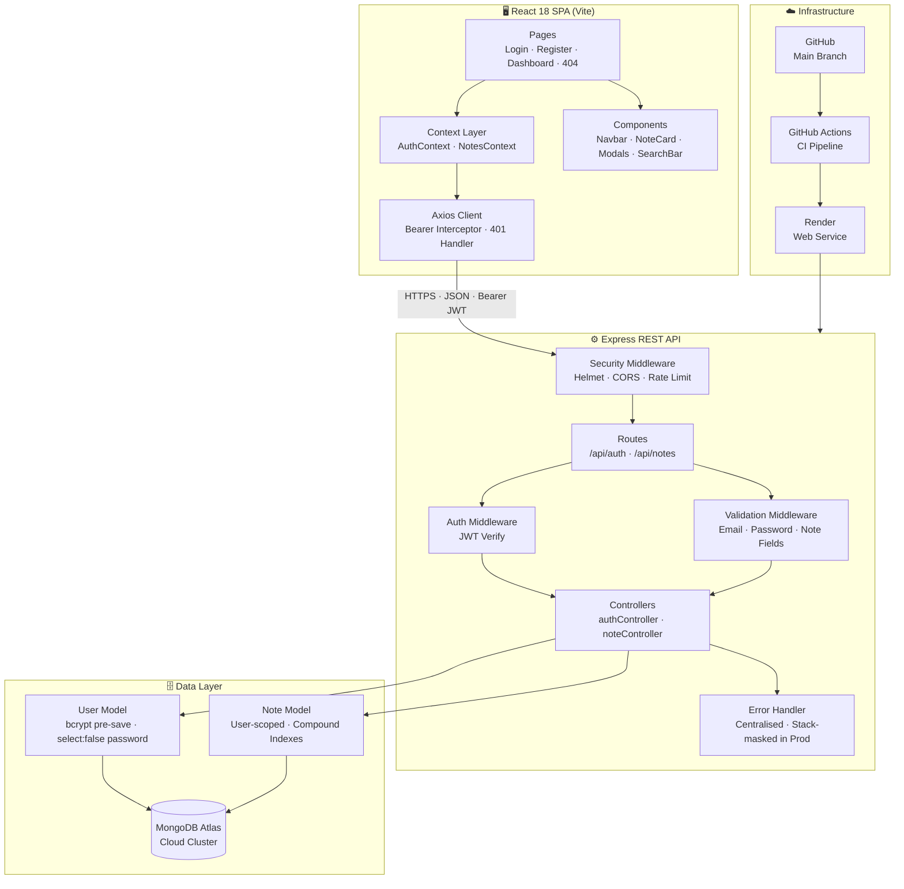
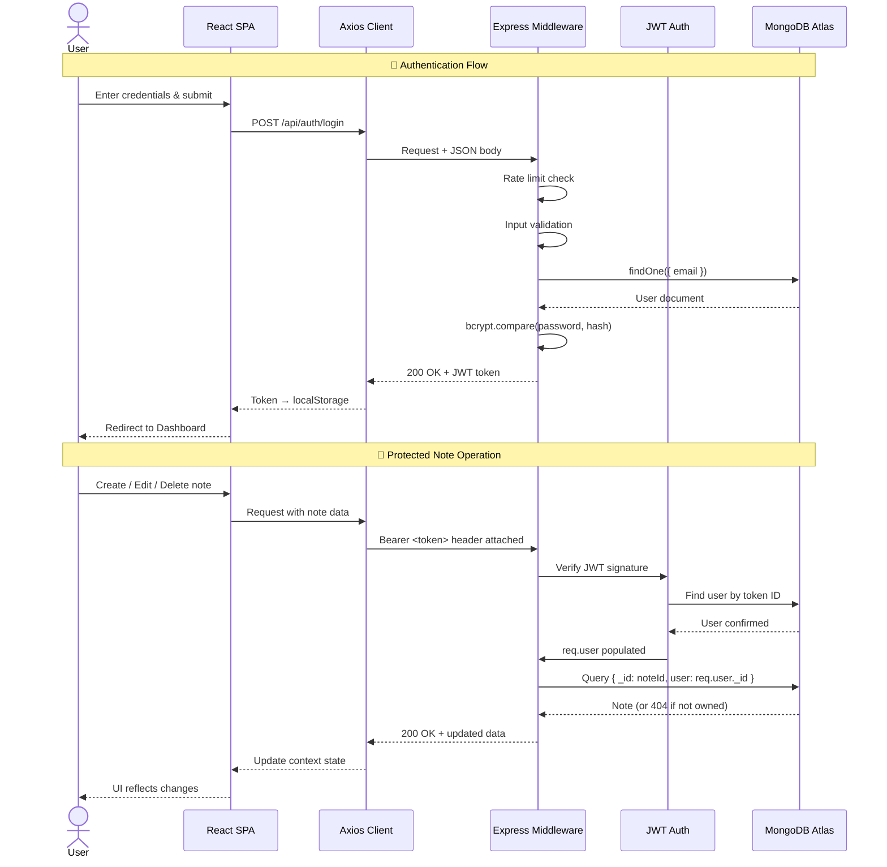
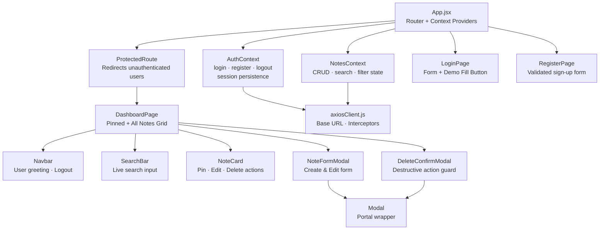

<div align="center">

# 📝 NoteSphere

### A Production-Ready Full-Stack Notes Application

[](https://notes-app-2arl.onrender.com)
[](https://github.com/SidharthA7204/notes-app)

[](https://nodejs.org)
[](https://expressjs.com)
[](https://reactjs.org)
[](https://mongodb.com)
[](https://vitejs.dev)
[](https://docker.com)
[](./server/tests)
[](./LICENSE)

<br/>

> A secure, scalable personal notes application built with a clean **REST API**, **JWT authentication**, and a **React SPA** frontend — deployed on Render with MongoDB Atlas.

<br/>

**🔗 [Live App](https://notes-app-2arl.onrender.com) · [API Docs](#-api-reference) · [Architecture](#%EF%B8%8F-system-architecture) · [Quick Start](#-quick-start)**

> ⚡ **Demo credentials:** `demo@example.com` / `demo@example.com`  
> *(Free tier — first load may take ~50s to wake up)*

</div>

---

## 📋 Table of Contents

- [Features](#-features)
- [Tech Stack](#-tech-stack)
- [System Architecture](#%EF%B8%8F-system-architecture)
- [Data Flow](#-data-flow)
- [Component Architecture](#-frontend-component-architecture)
- [Project Structure](#-project-structure)
- [Quick Start](#-quick-start)
- [API Reference](#-api-reference)
- [Security](#-security-implementation)
- [Testing](#-testing)
- [Deployment](#-deployment)
- [Environment Variables](#%EF%B8%8F-environment-variables)

---

## ✨ Features

<table>
<tr>
<td>

### 🔐 Authentication
- Secure register & login with JWT
- Bcrypt password hashing (salt × 10)
- Persistent sessions via localStorage
- Auto-logout on token expiry

</td>
<td>

### 📝 Notes Management
- Full CRUD (Create, Read, Update, Delete)
- Pin/unpin important notes
- 7 categories (Work, Personal, Ideas…)
- Live search across title & content

</td>
</tr>
<tr>
<td>

### 🛡️ Security
- IDOR prevention (user-scoped queries)
- Rate limiting on auth endpoints
- Helmet HTTP security headers
- Input validation middleware

</td>
<td>

### 🚀 Production-Grade
- Docker multi-stage build
- GitHub Actions CI/CD pipeline
- MongoDB Atlas cloud database
- In-memory DB fallback for local dev

</td>
</tr>
</table>

---

## 🛠 Tech Stack

| Layer | Technology | Purpose |
|:--|:--|:--|
| **Runtime** | Node.js 20 LTS | Server-side JavaScript |
| **Framework** | Express 4.x | REST API routing & middleware |
| **Database** | MongoDB + Mongoose | Document storage & ODM |
| **Cloud DB** | MongoDB Atlas | Production database hosting |
| **Auth** | JSON Web Tokens (JWT) | Stateless authentication |
| **Security** | bcryptjs, Helmet, express-rate-limit | Password hashing & HTTP hardening |
| **Frontend** | React 18 + Vite | SPA with hot module replacement |
| **HTTP Client** | Axios | API calls with interceptors |
| **Icons** | Lucide React | Consistent icon system |
| **Testing** | Vitest + Supertest | Unit & integration tests |
| **Container** | Docker (multi-stage) | Reproducible builds |
| **CI/CD** | GitHub Actions | Automated test & lint pipeline |
| **Hosting** | Render | Zero-config cloud deployment |

---

## 🏛️ System Architecture



---

## 🔄 Data Flow



---

## 🧩 Frontend Component Architecture



---

## 📁 Project Structure

```
notes-app/
├── 📄 package.json              # Root orchestrator (dev, build, test scripts)
├── 🐳 Dockerfile                # Multi-stage production build
├── 🐳 docker-compose.yml        # Local full-stack compose setup
├── ☁️  render.yaml              # Render.com blueprint
├── 📄 README.md
│
├── server/                      # ⚙️ Node.js + Express REST API
│   ├── package.json
│   ├── vitest.config.js
│   ├── .env.example
│   ├── scripts/
│   │   └── seed-demo.js         # Seed demo account to Atlas
│   ├── src/
│   │   ├── server.js            # Entry point + graceful shutdown
│   │   ├── app.js               # Express app + middleware stack
│   │   ├── config/
│   │   │   └── db.js            # Atlas connect + MongoMemoryServer fallback
│   │   ├── controllers/
│   │   │   ├── authController.js    # register · login · getMe
│   │   │   └── noteController.js    # CRUD with strict ownership
│   │   ├── middleware/
│   │   │   ├── authMiddleware.js    # JWT Bearer verification
│   │   │   ├── errorMiddleware.js   # 404 + centralised error handler
│   │   │   └── validateMiddleware.js # Input validation rules
│   │   ├── models/
│   │   │   ├── User.js              # bcrypt pre-save · select:false password
│   │   │   └── Note.js              # User-scoped · compound indexes
│   │   ├── routes/
│   │   │   ├── authRoutes.js        # /api/auth/*
│   │   │   └── noteRoutes.js        # /api/notes/*
│   │   └── utils/
│   │       └── generateToken.js     # JWT signing utility
│   └── tests/
│       ├── globalSetup.js           # MongoMemoryServer lifecycle
│       ├── auth.test.js             # 9 auth integration tests
│       └── notes.test.js            # 10 notes CRUD tests
│
└── client/                      # 🖥️ React 18 + Vite SPA
    ├── package.json
    ├── vite.config.js           # Dev proxy → localhost:5000
    ├── index.html
    └── src/
        ├── App.jsx              # Routes + provider tree
        ├── main.jsx
        ├── api/
        │   └── axiosClient.js       # Base URL · JWT interceptor · 401 handler
        ├── context/
        │   ├── AuthContext.jsx      # Login · register · logout · persistence
        │   └── NotesContext.jsx     # CRUD · search · category filter
        ├── components/
        │   ├── common/
        │   │   ├── Navbar.jsx
        │   │   ├── Modal.jsx
        │   │   ├── Alert.jsx
        │   │   ├── Spinner.jsx
        │   │   └── ProtectedRoute.jsx
        │   └── notes/
        │       ├── NoteCard.jsx
        │       ├── NoteFormModal.jsx
        │       ├── DeleteConfirmModal.jsx
        │       └── SearchBar.jsx
        ├── pages/
        │   ├── LoginPage.jsx        # Auth form + demo fill button
        │   ├── RegisterPage.jsx
        │   ├── DashboardPage.jsx    # Main notes interface
        │   └── NotFoundPage.jsx
        └── styles/
            └── index.css            # Design system (CSS variables + grid)
```

---

## ⚡ Quick Start

### Prerequisites
- Node.js ≥ 18
- npm ≥ 9
- MongoDB Atlas URI **or** nothing (auto in-memory fallback)

### 1. Clone & Install

```bash
git clone https://github.com/SidharthA7204/notes-app.git
cd notes-app
npm install          # installs root + client + server deps
```

### 2. Configure Environment

```bash
cp server/.env.example server/.env
# Edit server/.env — only MONGODB_URI is required for Atlas
# Leave it blank to use automatic in-memory MongoDB (zero config!)
```

### 3. Run (Development)

```bash
npm run dev
# React SPA  → http://localhost:5173
# Express API → http://localhost:5000
```

### 4. Run with Docker

```bash
docker compose up --build
# App → http://localhost:5000
```

### 5. Run Tests

```bash
npm test
# Runs 19 Vitest + Supertest integration tests
# No external DB required — uses MongoMemoryServer
```

---

## 📡 API Reference

**Base URL (Production):** `https://notes-app-2arl.onrender.com`  
**Base URL (Local):** `http://localhost:5000`

### Auth Endpoints

| Method | Endpoint | Auth | Description |
|:--|:--|:--|:--|
| `POST` | `/api/auth/register` | ❌ | Register new user |
| `POST` | `/api/auth/login` | ❌ | Login + receive JWT |
| `GET` | `/api/auth/me` | ✅ Bearer | Get current user profile |

<details>
<summary><strong>POST /api/auth/register</strong></summary>

**Request Body:**
```json
{
  "name": "Alex Developer",
  "email": "alex@example.com",
  "password": "securepassword123"
}
```
**Response `201`:**
```json
{
  "success": true,
  "token": "eyJhbGciOiJIUzI1NiIsIn...",
  "user": { "_id": "...", "name": "Alex Developer", "email": "alex@example.com" }
}
```
</details>

<details>
<summary><strong>POST /api/auth/login</strong></summary>

**Request Body:**
```json
{ "email": "alex@example.com", "password": "securepassword123" }
```
**Response `200`:**
```json
{
  "success": true,
  "token": "eyJhbGciOiJIUzI1NiIsIn...",
  "user": { "_id": "...", "name": "Alex Developer", "email": "alex@example.com" }
}
```
</details>

---

### Notes Endpoints *(all require `Authorization: Bearer <token>`)*

| Method | Endpoint | Description |
|:--|:--|:--|
| `GET` | `/api/notes` | List notes (search & filter) |
| `POST` | `/api/notes` | Create note |
| `GET` | `/api/notes/:id` | Get note by ID |
| `PUT` | `/api/notes/:id` | Update note |
| `DELETE` | `/api/notes/:id` | Delete note |

**Query Parameters for `GET /api/notes`:**

| Param | Type | Example | Description |
|:--|:--|:--|:--|
| `search` | string | `?search=meeting` | Case-insensitive search on title & content |
| `category` | string | `?category=Work` | Filter by category |
| `isPinned` | boolean | `?isPinned=true` | Filter pinned notes only |

<details>
<summary><strong>POST /api/notes — Request Body</strong></summary>

```json
{
  "title": "Sprint Planning Notes",
  "content": "Discussed Q4 roadmap and velocity targets.",
  "category": "Work",
  "isPinned": false
}
```
**Categories:** `Work` · `Personal` · `Ideas` · `Projects` · `Finance` · `General`
</details>

---

## 🔒 Security Implementation

| Threat | Mitigation |
|:--|:--|
| **IDOR / Unauthorised Access** | All note queries scoped to `{ _id, user: req.user._id }` — accessing another user's note returns `404` |
| **Brute Force / Credential Stuffing** | `express-rate-limit` on `/register` and `/login` endpoints |
| **Password Exposure** | `bcryptjs` with 10 salt rounds; `select: false` on User schema password field |
| **XSS / Clickjacking / MIME Sniffing** | `helmet` sets Content-Security-Policy and security headers |
| **Token Forgery** | HMAC-SHA256 JWT verified on every protected request |
| **Stack Trace Leakage** | Centralised error handler strips stack traces in `NODE_ENV=production` |
| **Injection** | Mongoose ODM + input validation middleware prevents malformed queries |

---

## 🧪 Testing

**19 tests — 0 failures**

```
server/tests/
├── auth.test.js      (9 tests)   — register, login, duplicate email,
│                                   wrong password, getMe, missing fields
└── notes.test.js    (10 tests)   — create, list, get, update, delete,
                                    search, category filter, ownership guard
```

```bash
npm test               # run all tests
npm test -- --coverage # with coverage report
```

> Tests use `mongodb-memory-server` — no external database required. CI runs these on every push via GitHub Actions.

---

## 🚀 Deployment

### Render (Production)

This repo includes a `render.yaml` blueprint. To deploy:

1. Push to GitHub
2. Connect repo in [Render Dashboard](https://dashboard.render.com)
3. Set environment variables (see below)
4. Render auto-detects `render.yaml` and deploys via Docker

### GitHub Actions CI

Every push to `main` runs `.github/workflows/ci.yml`:
- ✅ Install dependencies
- ✅ Run 19 integration tests
- ✅ Vite production build check

---

## ⚙️ Environment Variables

Create `server/.env` (copy from `server/.env.example`):

| Variable | Required | Description | Default |
|:--|:--|:--|:--|
| `PORT` | No | Server port | `5000` |
| `NODE_ENV` | No | `development` / `production` / `test` | `development` |
| `MONGODB_URI` | No* | MongoDB Atlas connection string | *In-memory fallback* |
| `JWT_SECRET` | **Yes** | Secret for signing tokens | — |
| `JWT_EXPIRES_IN` | No | Token expiry duration | `30d` |
| `CORS_ORIGIN` | No | Allowed origins (comma-separated) | `http://localhost:5173` |

> \* If `MONGODB_URI` is omitted, the server automatically starts an embedded `mongodb-memory-server` — perfect for local evaluation with zero setup.

---

## 🤝 Contributing

1. Fork the repo
2. Create a feature branch: `git checkout -b feat/your-feature`
3. Commit with conventional commits: `git commit -m "feat: add tag support"`
4. Push and open a Pull Request

Please ensure all 19 tests pass before submitting a PR.

---

## 📄 License

MIT © 2026 [Sidharth](https://github.com/SidharthA7204)

---

<div align="center">

**Built with ❤️ as a Junior Fullstack Assignment**

[🔗 Live Demo](https://notes-app-2arl.onrender.com) · [📁 GitHub](https://github.com/SidharthA7204/notes-app)

</div>
